# Drawing the Pattern Map

Oct 31, 2026

One working session between Mircea Lungu and Claude (Claude Code, Opus 5.5) on 28 October 2026, making the overview figure for the paper *Architectural Patterns for Integrating LLMs into User-Facing Applications*.

Mircea's messages are corrected for typos and grammar. Claude's replies are shortened to what they said, without progress notes and tool output. The ten intermediate figures are the renders Claude looked at during the session, recovered from the session log. Times are Copenhagen time. An orange bar in the margin marks the messages where Mircea directs the work or gives feedback on it.

**5 h 42 m** first message to last reply · **29** inputs from Mircea · **12** of them corrected the design · **11** versions of the figure · **184** tool calls by Claude

## Starting from a sketch in words

**Mircea** · 09:34  
If we were to design an overview image that shows how the patterns belong together, I'd draw a model, a prompt, the tests and the tolerant parsing together, and put them in a box. The prompt and the model are versioned. Then the output is sometimes sent directly to the user and stored, and sometimes sent to another validator first, then stored, then shown to the user. And so on. Do you see what I mean? We don't have to include all of them, but it would be good to see the ones that belong together.

**Claude** · 09:34  
Yes. There is a unit at the center (model, prompt, parser, tests, versioned together) and a pipeline the output flows through, with patterns at different stations. The candidate *One Wish per Genie* already names that unit a "task". It sketched the map in text: the task box, a trust-or-check fork, the stored row with its stamp and state, and the user's flag.

It suggested leaving out the efficiency patterns, since they describe when the task runs, not where the output goes, and asked whether to include the candidate patterns.

**Mircea** · 09:37  
We need one with candidates and one without, I guess. An overview in the Intro is good, or just as well at the end.

**Claude** · 09:42  
Drew both versions in TikZ from one shared source with a switch, so they can't drift apart. Candidate patterns are dashed. Left: prompt, LLM, parser and tests in one box. Middle: output either goes straight to storage or through a check, with a red reject arrow back to the prompt. Right: the stored row. Below: clean up on the way to the user, and the user's flag lowering the state.

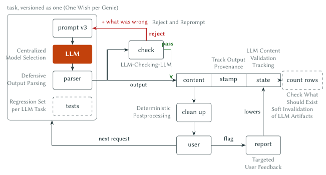
*V1 · 09:42. First draft. Cleanup sits on the way to the user, after storage.*

**Mircea** · 09:43  
Open the two images.

## Correcting the pipeline

**Mircea** · 09:44  
Nice. Cleanup should come before content, I guess.

**Claude** · 09:45  
Pointed out that Zeeguu's own example of *Deterministic Postprocessing* runs at serve time (that's how it fixed about 60,000 stored rows without a backfill), which is why it had put it there. The pattern allows either place, and before storage makes the picture simpler, so it moved it.

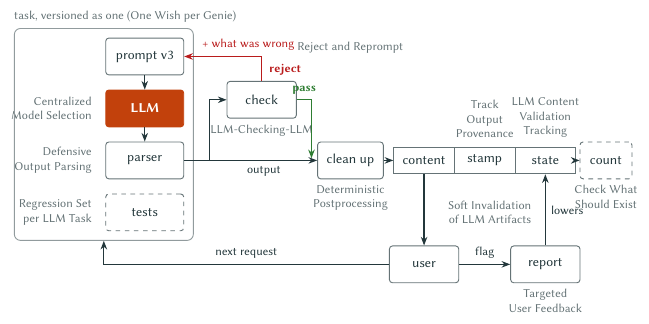
*V2 · 09:45. Clean up now sits before the stored row; the user reads straight from the store.*

**Mircea** · 09:46  
And in parallel with LLM-Checking-LLM, we also have another, non-LLM check?

**Claude** · 09:46  
Not as a pattern of its own: the cheap, non-LLM check lives inside **Reject and Reprompt**. It proposed drawing two check boxes side by side.

**Mircea** · 09:46  
Ah, that's Reject and Reprompt.

**Claude** · 09:46  
Agreed: the map already covers it through the red reject arrow. Offered a subtitle, "classical or LLM", in the check box.

## What is interchangeable: the model, or the model and its prompt?

**Mircea** · 09:58  
Centralized Model Selection should be Centralized Genie Selection, because it's genies that are interchangeable, not models.

**Claude** · 09:59  
Renamed the label in the figure, and flagged what follows: the pattern keeps its old name in six other files, the core version would use "genie", a word only a candidate pattern defines, and that pattern defines a genie as just the model.

**Mircea** · 10:00  
OK. But it should be outside the genie box, shouldn't it?

**Claude** · 10:00  
Yes. The task doesn't own the choice; one central table resolves it for every task. Drew the table outside the box, linked by a line that ends in a dot (a reference, not data flow).

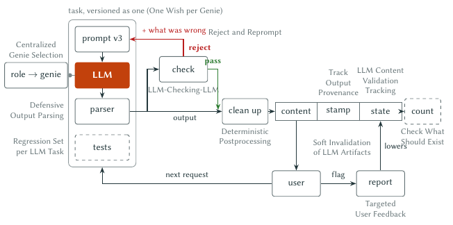
*V3 · 10:01. The selection table moves outside the box.*

**Mircea (mid-turn)** · 10:00  
Actually, prompt plus model is a genie.

**Mircea (mid-turn)** · 10:01  
So those should be in a box. Or with the parser too?

**Claude** · 10:02  
Put prompt, LLM and parser in one inner "genie" box. In the candidate version, that box sits inside a task box together with the tests, since the tests check the task whichever genie serves it. Listed three places where the paper's text now disagrees with the figure.

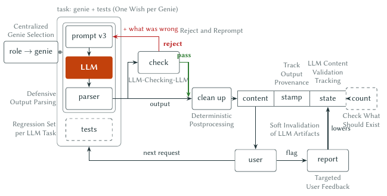
*V4 · 10:02. A genie box (prompt, LLM, parser) inside a task box with the tests.*

**Mircea** · 10:05  
Make the pattern names navy: bold if they're in the paper, italic if they're not?

**Claude** · 10:06  
Done: five names bold, seven italic. Noted that this breaks two of the paper's own diagram rules (no italics, gray labels only), so the map is an exception.

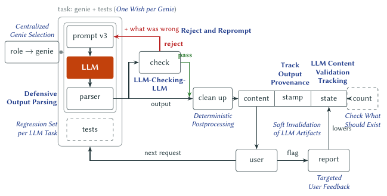
*V5 · 10:06. Pattern names in navy; bold means "in the PDF".*

**Mircea** · 10:07  
"Regression Set per LLM Task": either LLM Task or Genie.

**Claude** · 10:07  
Argued for "per LLM Task": the set belongs to the job, so a new model or a fallback must pass the same set as the one it replaces. Per genie, the sets couldn't be compared.

**Mircea** · 10:08  
Aha. Genies work on tasks. Fair enough.

**Mircea** · 10:12  
The parser should be outside the "genie"… Actually, the genie is the model! Though even with the parser, our thing is still a genie. It might still not do what we want.

**Claude** · 10:12  
That's the definition the paper already has: the genie is the model, the wish is the prompt, settings and parser. The real confusion was "task", which the paper used both for the job and for the genie-plus-wish pair. Proposed: *task* = the job, *genie* = the model, *wish* = prompt, settings, parser.

And the second point is the stronger one: even a well-worded wish with a strict parser is still a genie. It grants the wish as written, not as meant, which is why everything to the right of the box exists.

*· · · 52 minutes · · ·*

**Mircea** · 11:04  
Yes.

**Mircea (mid-turn)** · 11:04  
Also, our central dispatcher should also map each task to a main genie and a backup.

**Claude** · 11:05  
Redrew with "genie" under the LLM and "wish" on prompt and parser; the central table now reads "task → genie, main, backup", back under the name *Centralized Model Selection*.

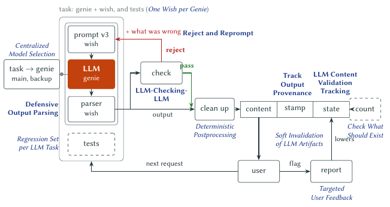
*V6 · 11:05. Genie and wish labeled; the table maps a task to its main and backup genie.*

*· · · an hour: Mircea renames the pattern in another session · · ·*

**Mircea** · 12:05  
"Genie" is out of the vocabulary. The pattern has been renamed: One Wish per Genie is now Model-Bound Prompt.

One more observation. Four of the paper's nine patterns aren't on either map: Prompt Amortization, Escalate to the LLM, Anticipatory Precomputation, and Rent, Then Build. Those are the "using the LLM efficiently" ones. Say it in one sentence: "the cost patterns sit around this pipeline, not in it". Otherwise the workshop groups that reviewed them will wonder where theirs went.

**Claude** · 12:07  
Removed "genie" everywhere. The pair is now "model + prompt, versioned as one"; the candidate box reads "task: model + prompt (*Model-Bound Prompt*), and tests". Drafted a caption carrying the cost-patterns sentence.

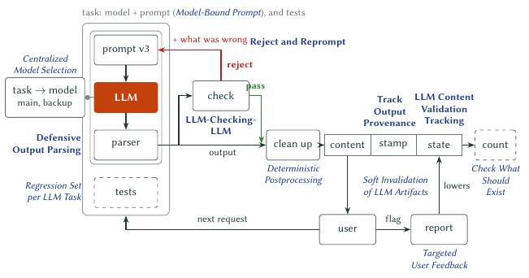
*V7 · 12:07. No more genies: model + prompt, versioned as one.*

## Adding the cost patterns

**Mircea** · 12:08  
Can we add the missing patterns first?

**Claude** · 12:10  
Placed all four around the pipeline: a user's request goes to a cheap tool first and escalates; a scheduled job feeds predicted items; both go through a batch box into the task; the stored content becomes training data for an own model that will replace the LLM.

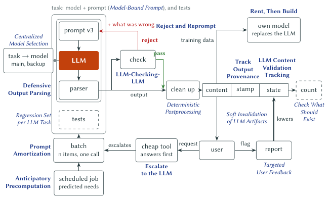
*V8 · 12:10. All nine paper patterns on the map. The escalation runs through the batch.*

**Mircea** · 12:11  
Escalate doesn't go into Prompt Amortization… does it?

**Mircea (mid-turn)** · 12:11  
Or at least not always.

**Claude** · 12:12  
Right, and the paper backs it: batching "adds a wait" and needs "work that nobody is waiting on", while an escalation has a user waiting. The escalation now goes straight into the task; only the scheduled job feeds the batch.

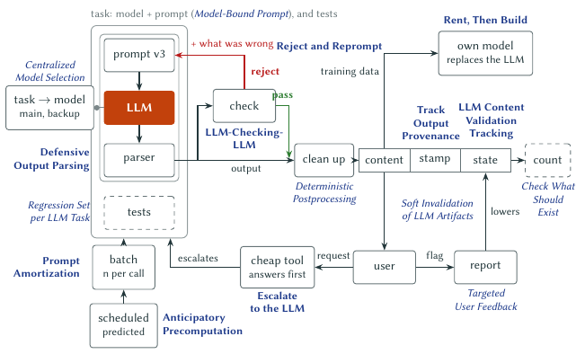
*V9 · 12:12. Escalation bypasses the batch.*

**Mircea** · 12:12  
What is this "count"?

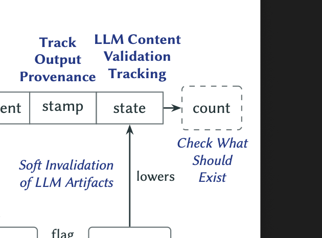
*Screenshot. Mircea's crop of V9.*

**Claude** · 12:12  
It stands for *Check What Should Exist*: a check outside the pipeline that compares what was stored with what should have been, and alerts when rows go missing. "count" is a bad name, and the arrow wrongly suggests it reads the validation state. Proposed a "monitor" box fed by the rows, with an alert.

**Mircea** · 12:13  
The monitor is important. Yes, do that, and then upload the new version.

**Claude** · 12:16  
Asked what "upload" should mean; Mircea chose to embed the map in the Intro and then sync. Added a `site-skip` marker so the PDF shows the core map and the site the one with candidates, embedded both with captions, and pushed.

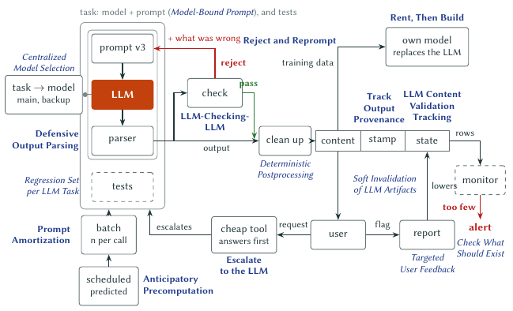
*V10 · 12:14. "count" becomes a monitor fed by the rows, with a red "too few → alert".*

**Mircea** · 12:17  
Synced?

**Mircea** · 12:25  
[Pasted Claude's summary back, with one note:] Move "pass" to the right.

## Making the names clickable

**Mircea** · 12:57  
Whoa. For the website, could we make them links?

**Mircea (mid-turn)** · 12:58  
Even for the paper, if it's possible, that would be nice!

**Mircea** · 13:11  
[After the session broke off when the laptop went to sleep:] Continue.

**Claude** · 13:15  
Each pattern label in the TikZ source now records its box when the figure builds. A small script turns those boxes into transparent links in the site's SVG and into PDF link annotations in the paper: bold names jump to their section, italic ones open the website. One snag on the way: the LaTeX driver only draws links around visible text, so the link areas had to become explicit PDF annotations.

**Mircea** · 14:21  
Did you push and sync?

**Claude** · 14:21  
Not yet; it had stopped to ask first. Synced and pushed.

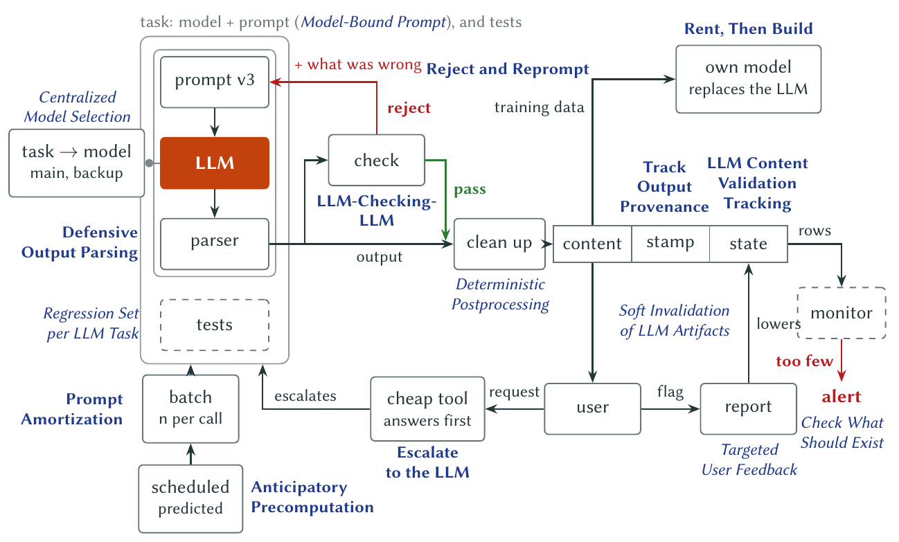
*Final · 14:21. The published map with candidates. Every navy name is a link.*

---

*The session log has a few more renders between these versions: layout fixes for overlaps and the 15 cm page width. The ones shown are the last render before each of Mircea's messages.*
